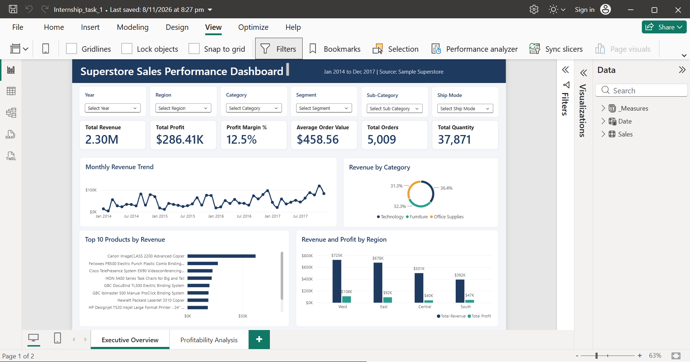
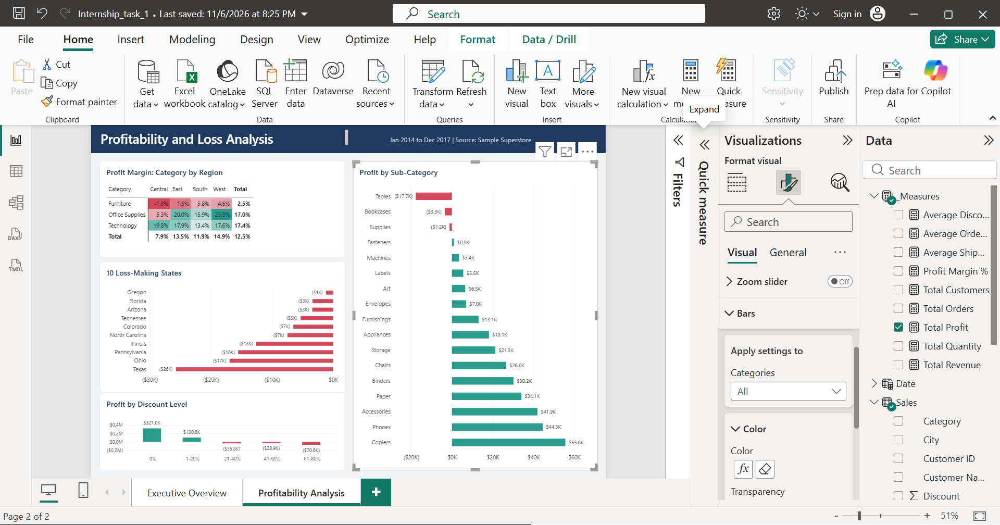

# Superstore Sales Performance Dashboard (Power BI)

An interactive two-page Power BI dashboard and business analysis of four years of retail sales (2014 to 2017). The project covers data cleaning in Power Query, a data model with a custom Date table, DAX measures, dashboard design and a written business report with data-backed recommendations.

## Business Questions

- Is the business growing, and what drives the growth?
- Which products, categories, regions and customer segments perform best and worst?
- Where is the business losing money, and why?
- When do sales peak?

## Dataset

Sample Superstore sales data (US office-products retailer), one row per product line on an order.

| Item | Detail |
|---|---|
| Rows | 9,993 after cleaning (9,994 raw) |
| Period | 3 Jan 2014 to 30 Dec 2017 |
| Orders / customers | 5,009 / 793 |
| Geography | United States, 4 regions, 49 states |
| Categories | 3 categories, 17 sub-categories |

The data has no cost, returns or customer demographic fields, so only metrics that can be calculated from the actual columns are used.

## Tools

- Power BI Desktop (free version)
- Power Query (M) for cleaning
- DAX for measures and a calculated Date table

## Data Cleaning (Power Query)

- Converted text dates (US month/day/year) using the English (United States) locale
- Removed 1 duplicate row, plus the unneeded Row ID and Country columns
- Restored 449 postal codes that had lost their leading zero and stored them as text
- Trimmed text and removed hidden non-breaking spaces in product names
- Handled special characters in customer names with the correct file encoding
- Checked for missing values, zero or negative sales and quantities, and impossible shipping dates (none found)
- Kept genuine outliers (large sales and large losses), because they are real business events
- Added a Shipping Days column

## Data Model

- `Sales` fact table related to a `Date` dimension (many-to-one on Order Date), with the Date table marked as the date table
- Product and geography were kept in the fact table because 32 Product IDs have two names and some postal codes map to two cities, so separate tables would break one-to-many relationships
- Measures live in a dedicated `_Measures` table

## DAX Measures

| Measure | Purpose |
|---|---|
| Total Revenue, Total Profit, Total Quantity | Core totals |
| Total Orders, Total Customers | Distinct counts |
| Average Order Value | Revenue divided by orders |
| Profit Margin % | Profit divided by revenue |
| Average Discount, Average Shipping Days | Operational KPIs |
| Revenue PY, Revenue YoY Growth % | Year-over-year comparison |
| Revenue PM, Revenue MoM Growth % | Month-over-month comparison |
| Revenue YTD | Running total within the year |
| Profit PY, Profit YoY Growth % | Profit trend |
| Product Revenue Rank | Ranks products by revenue |

## Dashboard Pages

**Executive Overview:** six KPI cards, monthly revenue trend, revenue by category, top 10 products, revenue and profit by region, and slicers for year, region, category, segment, sub-category and ship mode.

**Profitability Analysis:** profit margin matrix (category by region), profit by sub-category, the ten loss-making states, and profit by discount level.

## Key Insights

- Revenue grew about 14.9% a year, from $484K (2014) to $733K (2017). Growth came from more orders (+74%) while average order value fell 13%.
- Q4 delivers 38.2% of revenue, and November and December alone deliver 29.5%.
- Technology earns 50.8% of profit. Furniture earns 32.3% of revenue but only 6.4% of profit (2.49% margin).
- Order lines discounted by more than 20% lost $135,364 in total. Profit turns negative once discounts pass 20%.
- 10 of 49 states lose money, led by Texas, Ohio, Pennsylvania and Illinois. The Central region has a 7.92% margin against 14.94% in the West.
- Tables, Bookcases and Supplies are the loss-making sub-categories.

## Recommendations

1. Cap discounts at 20% and require approval above it.
2. Start discount controls in the Central region and the four biggest loss-making states.
3. Reprice or review Tables and Bookcases, and limit discounts on Chairs.
4. Review the 301 loss-making products, starting with the worst performers.
5. Grow high-margin areas (Copiers, Accessories, Technology, Home Office) without deep discounting.
6. Plan inventory and promotions around the Q4 peak and work on raising average order value.

The full write-up is in [`report/`](report/).

## How to Open

1. Install the free Power BI Desktop (Windows).
2. Open `Business Sales Performance Analytics.pbix`.
3. If the data path breaks, go to **Home > Transform data > Data source settings** and point it to `data/Sample_-_Superstore.csv`.

## Author

Faisal Khan
